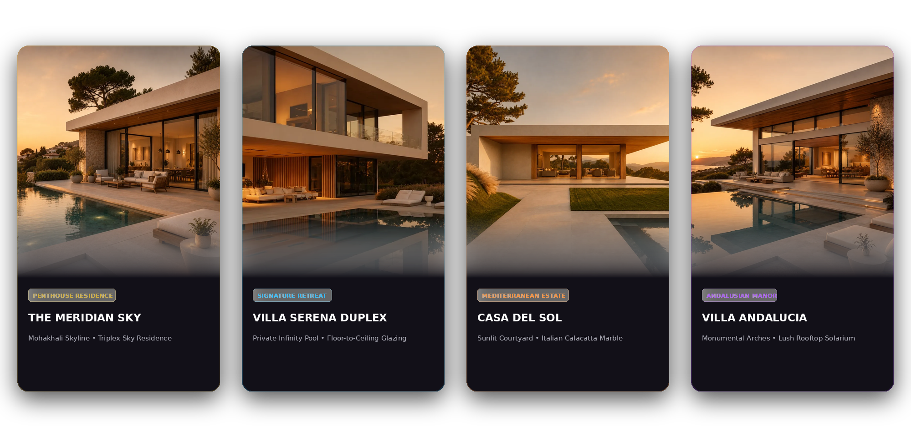

<div align="center">

# 🏰 MAISON DHAKA — Ultra-Luxury Architectural Living
### Bespoke Mediterranean Residences in Mohakhali Engineered with Next.js 15, GSAP & Lenis

[](https://maisondhaka.pages.dev/)
[](https://nextjs.org/)
[](https://react.dev/)
[](https://greensock.com/gsap/)
[](https://lenis.darkroom.engineering/)
[](https://maisondhaka.pages.dev/)
[](LICENSE)

<br/>

**[⚡ View Live Production Deployment](https://maisondhaka.pages.dev/)** &nbsp;•&nbsp; **[📦 GitHub Repository](https://github.com/labibfohayer/Maison-Dhaka)**

<br/>



</div>

---

## 📌 Architectural Overview

**Maison Dhaka** is an ultra-exclusive architectural real estate platform engineered for Mohakhali DOHS, Dhaka. The platform bridges Mediterranean villa aesthetics with contemporary European minimalism, providing high-net-worth clients with an immersive spatial portfolio of luxury penthouses, private duplex estates, and sunlit courtyard sanctuaries.

Engineered with **Next.js 15 (App Router)** and **React 19**, the architecture prioritizes sub-frame visual precision—orchestrating continuous video scrubbing across a 300vh scroll trajectory via **GSAP ScrollTrigger**, zero-jitter inertial physics powered by **Lenis**, and smooth glassmorphic interface layers.

---

## ⚡ Key Engineering Highlights

```
+-------------------------------------------------------------+
|                   THE ARCHITECTURAL JOURNEY                 |
|                                                             |
|  [Pinned 300vh Hero]  -->  [Morphing Drawer]  -->  [Villa]  |
|  * GSAP Video Scrub        * Dynamic SVG Clip       * Zoom  |
|  * Pinned Viewport Lock    * Lenis Inertial Sync    * Modal |
+-------------------------------------------------------------+
```

1. **Scroll-Scrubbed Architectural Hero:**
   - Sticky `300vh` scroll viewport locking video playback to user scroll velocity.
   - Smooth frame interpolation preventing stutters on high-refresh (120Hz/144Hz) displays.

2. **Sub-Pixel Kinetic Navigation:**
   - Fullscreen morphing drawer with SVG `clip-path` polygon curtain reveal.
   - Word-by-word dynamic opacity lighting up as narrative statements enter the viewport.

3. **Curated Villa Portfolio:**
   - 2-Column architectural residence gallery with mouse-tracking parallax zoom.
   - Integrated backdrop-blur glassmorphism inquiry concierge with instant submission feedback.

---

## 🛠️ Tech Stack & Production Architecture

| Layer | Technologies | Purpose |
| :--- | :--- | :--- |
| **Framework** | Next.js 15 (App Router), React 19, TypeScript | Server-first rendering, zero-runtime overhead |
| **Styling** | Tailwind CSS 3.4, PostCSS, Glassmorphism | Custom design tokens, luxury typography scale |
| **Animation** | GSAP 3.12, ScrollTrigger, Framer Motion 11 | Hardware-accelerated transforms, scrub timelines |
| **Smooth Scroll**| Lenis 1.1 Inertial Engine | Sub-pixel fluid scrolling with normalized touch kinematics |
| **Deployment** | Cloudflare Pages, Edge CDN Distribution | Sub-50ms TTFB global delivery |

---

## 🚀 Getting Started & Local Development

```bash
# Clone the repository
git clone https://github.com/labibfohayer/Maison-Dhaka.git
cd Maison-Dhaka

# Install dependencies
npm install

# Start development server
npm run dev
```

Open [http://localhost:3000](http://localhost:3000) to view the live development instance.

---

## 📄 License
This project is open-source and distributed under the [MIT License](LICENSE).
